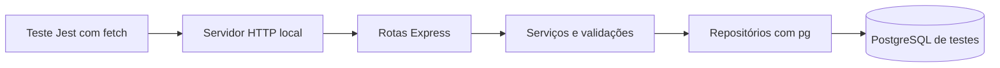

# Testes de integração — API de alunos, disciplinas e matrículas

Este projeto didático demonstra como verificar a integração entre uma API HTTP em Express, suas regras de negócio e um banco PostgreSQL real. A aplicação permite cadastrar alunos e disciplinas e registrar matrículas.

Os testes estão em [server/test/integration/](server/test/integration/) e contêm 47 casos em cinco suítes, contando as variações de `test.each`. 

## Organização atual dos testes

A pasta `server/test/` contém dois diretórios: `integration/`, com os cenários executáveis, e `support/`, com a infraestrutura compartilhada. O auxiliar de banco fica em `test/support/database.ts`.

| Suíte | Casos | Responsabilidade |
| --- | --- | --- |
| [students.test.ts](server/test/integration/students.test.ts) | 2 | Cadastro, persistência, busca, ordenação e limites válidos de alunos. |
| [courses.test.ts](server/test/integration/courses.test.ts) | 1 | Cadastro, ID gerado, persistência, busca e ordenação de disciplinas. |
| [enrollments.test.ts](server/test/integration/enrollments.test.ts) | 10 | Matrículas, chave composta, data, ordenação, duplicação, referências inexistentes e campos obrigatórios. |
| [http.test.ts](server/test/integration/http.test.ts) | 6 | Healthcheck, rota desconhecida, coleções vazias e erros do parser JSON. |
| [errors.test.ts](server/test/integration/errors.test.ts) | 28 | Unicidade de alunos e disciplinas, recursos ausentes e validações compartilhadas entre recursos. |

Um caso pode conter várias requisições e asserções. A divisão por arquivo organiza os assuntos; a quantidade de casos não representa a quantidade de endpoints ou de comportamentos verificados.

| Auxiliar | Responsabilidade |
| --- | --- |
| [database.ts](server/test/support/database.ts) | `createTestDatabase()` cria o cliente e o schema e fornece abertura, rollback e encerramento. |
| [http.ts](server/test/support/http.ts) | `createHttpClient()` fornece `request()`, `rawRequest()` e `expectError()`. |
| [fixtures.ts](server/test/support/fixtures.ts) | `createEnrollmentPrerequisites()` cadastra aluno e disciplina pela API e retorna suas chaves. |
| [integration-app.ts](server/test/support/integration-app.ts) | `useIntegrationApp()` combina os auxiliares, registra os hooks e inicia e encerra o servidor. |

## O que os testes integram

Cada requisição percorre as camadas reais da aplicação:



As rotas recebem JSON e interpretam os parâmetros; os serviços validam os dados e aplicam regras; os repositórios executam SQL parametrizado. O Express devolve o resultado como resposta HTTP.

Por exemplo, o teste de matrícula duplicada cadastra um aluno e uma disciplina, realiza a matrícula e repete a operação. O PostgreSQL rejeita a duplicação pela chave primária composta, o serviço traduz essa violação e a API responde com `409 Conflict`. O teste verifica toda essa colaboração.

Não há mocks de serviços, repositórios ou consultas. Jest executa os casos, ts-jest processa TypeScript, `fetch` envia requisições reais e `pg.Client` mantém a conexão com o banco. Algumas verificações também consultam diretamente as tabelas para confirmar os dados gravados dentro da transação.

## Como executar

### 1. Iniciar o banco de testes

Instale Node.js 24 e Docker com suporte a Docker Compose. Mantenha o Docker em execução. Na raiz do projeto, execute:

```powershell
docker compose -f compose.test.yml up -d --wait
```

O comando inicia somente o PostgreSQL exclusivo dos testes e aguarda seu healthcheck. O servidor HTTP será iniciado pela própria suíte.

Use `compose.test.yml` sozinho, como no comando acima. Ele é uma configuração independente; não é necessário combiná-lo com `compose.yml` nem iniciar o frontend ou a API da demonstração.

### 2. Instalar dependências e executar os testes

```powershell
cd server
npm ci
npm test
```

O Jest procura arquivos `test/integration/**/*.test.ts`. O comando usa `--runInBand` para executar a suíte em série, mantendo a execução simples para a aula. Dentro de cada arquivo, os testes compartilham uma conexão e usam transações para isolar os dados. Arquivos diferentes recebem conexões e schemas próprios. Não use `test.concurrent` nessa estrutura.

Uma execução bem-sucedida apresenta:

```text
Test Suites: 5 passed, 5 total
Tests:       47 passed, 47 total
```

### 3. Verificar cobertura, tipos e compilação

Ainda em `server`:

```powershell
npm run test:verbose
npm run test:coverage
npm run test:typecheck
npm run build
```

| Comando | Finalidade |
| --- | --- |
| `npm test` | Executar os testes com HTTP e PostgreSQL reais. |
| `npm run test:verbose` | Mostrar o nome e o resultado de cada cenário. |
| `npm run test:coverage` | Executar a suíte e medir o código percorrido. |
| `npm run test:typecheck` | Verificar os tipos da aplicação e dos testes, sem gerar arquivos. |
| `npm run build` | Compilar o código de produção para `server/dist/`. |

O relatório HTML fica em `server/coverage/index.html`. A medição inclui `src/**/*.ts`, exceto `main.ts` e `database/connection.ts`, responsáveis pela inicialização de produção e configuração do Pool. Não há percentual mínimo obrigatório. Cobertura mostra o código executado; as asserções determinam os comportamentos verificados.

### 4. Encerrar o banco

Volte à raiz e execute:

```powershell
cd ..
docker compose -f compose.test.yml down
```

O banco usa armazenamento temporário (`tmpfs`). Seus dados são descartados ao remover o contêiner.

## Configuração da conexão

O arquivo [compose.test.yml](compose.test.yml) configura o ambiente abaixo:

| Configuração | Valor |
| --- | --- |
| Serviço | `database-test` |
| Imagem | `postgres:18-alpine` |
| Host acessível pelo Node.js local | `127.0.0.1` |
| Porta publicada | `5434` |
| Porta interna do PostgreSQL | `5432` |
| Banco | `aula3_test` |
| Usuário e senha | `postgres` |

O auxiliar de banco lê somente `TEST_DATABASE_URL` para configurar a conexão. Não carrega `.env` nem utiliza as variáveis `DB_*` da aplicação. Com os valores padrão, não é necessário criar `.env` para executar os testes.


## Isolamento e ciclo de vida

Cada arquivo de testes usa seu próprio schema, sua conexão PostgreSQL e seu servidor HTTP. Dentro do arquivo, cada teste usa uma transação. O auxiliar `useIntegrationApp()`, chamado dentro de `describe`, registra os hooks desse ciclo de vida.

| Etapa do Jest | Operações |
| --- | --- |
| `beforeAll` | Conecta ao PostgreSQL, cria um schema com prefixo `integration_` e UUID, configura o `search_path`, aplica `database/init.sql` e inicia o Express. |
| `beforeEach` | Executa `BEGIN` antes de cada teste. |
| Teste | Prepara seus registros, envia requisições e verifica as respostas e os dados. |
| `afterEach` | Executa `ROLLBACK`, desfazendo as alterações do teste. |
| `afterAll` | Fecha o servidor e suas conexões HTTP, executa um rollback de limpeza, remove o schema com `DROP SCHEMA ... CASCADE` e encerra o cliente PostgreSQL. |

`createApp(client)` recebe o mesmo cliente PostgreSQL usado no controle das transações. Por isso, as consultas dos repositórios participam da transação aberta pelo teste. O servidor escuta em `127.0.0.1` com porta `0`, permitindo que o sistema operacional escolha uma porta disponível.

A suíte aplica o SQL de criação das tabelas, mas não executa `database/seed.sql`. Cada teste prepara seus próprios dados. O auxiliar `fixtures()`, baseado em `createEnrollmentPrerequisites()`, cadastra um aluno e uma disciplina por HTTP nos cenários que precisam desses registros.

Sequências de IDs do PostgreSQL podem avançar mesmo após um `ROLLBACK`. Assim, os testes usam os IDs retornados pela API, sem pressupor que toda disciplina receberá o ID `1`.

## Cenários verificados

| Área | Verificações |
| --- | --- |
| Aplicação HTTP | Healthcheck com `200`, rota inexistente com `404` e respostas JSON. |
| Coleções vazias | Alunos, disciplinas e matrículas retornam `[]`. |
| Alunos | Criação com `201`, busca por RA, persistência e ordenação pelo nome. |
| Disciplinas | ID gerado pelo banco, criação, busca, persistência e ordenação por ID. |
| Matrículas | Criação, busca pela chave composta, persistência, ordenação por RA e curso e data ISO no JSON. |
| Campos extras | Campos adicionais não aparecem nos registros retornados nos cenários de criação verificados. |
| Unicidade | RA repetido, nome de disciplina repetido e matrícula duplicada retornam `409`. |
| Chaves estrangeiras | Matrícula com aluno ou disciplina inexistente retorna `404`. |
| Recursos ausentes | Busca de aluno, disciplina ou matrícula inexistente retorna `404`. |
| Identificadores nas URLs | Zero, negativos, decimais, texto misturado, notação exponencial e valores acima do limite retornam `400`. |
| Corpos e nomes inválidos | Tipos inadequados, campos ausentes, nomes curtos, espaços e nomes acima do limite são rejeitados. |
| Chaves no JSON | Valores inválidos de RA e curso e ausência das chaves obrigatórias retornam `400`. |
| Limites válidos | RA `2147483647` e nome com 100 caracteres são aceitos no cadastro de aluno. |
| Parser JSON | JSON malformado retorna `400`; corpo acima do limite retorna `413`. |

Nos erros, os testes verificam o status HTTP e a estrutura `{ statusCode, message, error }`. Nos cenários de criação e consulta, comparam os dados esperados. Consultas SQL diretas confirmam a persistência de alunos, disciplinas e matrículas dentro da transação.

## Como ler e ampliar os testes

Cada caso prepara os dados, executa uma operação e verifica o resultado. O auxiliar `request()` envia JSON, verifica o `Content-Type` e devolve status e corpo da resposta. `expectError()` verifica o contrato dos erros `400`, `404` e `409`; os casos do parser verificam diretamente as respostas `400` e `413`.

Para enviar texto que não é JSON válido, `http.test.ts` usa `rawRequest()`: ele retorna a `Response` original do `fetch` e permite configurar o corpo sem passar por `JSON.stringify`. As requisições têm limite padrão de cinco segundos. A conexão PostgreSQL também tem limite de cinco segundos, e o `beforeAll` permite até quinze segundos para preparar o banco e iniciar o servidor.

Este trecho demonstra um conflito de matrícula provocado no banco real:

```typescript
const keys = await fixtures();

expect((await request("/api/enrollments", "POST", keys)).status).toBe(201);

await expectError("/api/enrollments", 409, "POST", keys);
```

Ao adicionar cenários, prepare os dados necessários no próprio teste, aguarde as operações assíncronas e use `test.each` para variações de entrada. Mantenha os casos independentes da ordem e aproveite os hooks existentes para a limpeza.

Uma violação SQL, como uma duplicação, deixa a transação PostgreSQL em estado de erro até o `ROLLBACK`. Nos testes atuais, a requisição que provoca essa violação é a última operação do caso. Considere esse comportamento antes de acrescentar consultas depois de um erro do banco.

## Estrutura relevante

```text
.
├── .github/workflows/integration-tests.yml # Verificação automática no GitHub
├── compose.test.yml                   # PostgreSQL exclusivo dos testes
├── compose.yml                        # Aplicação completa
├── database/
│   ├── init.sql                       # Tabelas e restrições usadas pela suíte
│   └── seed.sql                       # Dados da demonstração; não usados nos testes
├── front/                            # Interface da demonstração
└── server/
    ├── jest.config.cjs                # Descoberta, transformação e cobertura
    ├── tsconfig.test.json             # Tipagem da aplicação e dos testes
    ├── package.json                   # Dependências e comandos
    ├── test/
    │   ├── integration/
    │   │   ├── students.test.ts       # Cadastro, consulta e limites de alunos
    │   │   ├── courses.test.ts        # Cadastro e consulta de disciplinas
    │   │   ├── enrollments.test.ts    # Matrículas, ordenação e restrições
    │   │   ├── http.test.ts           # Healthcheck, coleções e parser JSON
    │   │   └── errors.test.ts         # Validações e erros entre recursos
    │   └── support/
    │       ├── database.ts           # Schema, conexão e limpeza
    │       ├── http.ts               # Requisições e asserções de erros
    │       ├── fixtures.ts           # Pré-requisitos criados pela API
    │       └── integration-app.ts    # Servidor e hooks de cada suíte
    └── src/
        ├── app.ts                    # createApp(db), rotas e tratamento de erros
        ├── main.ts                   # Inicialização de produção
        ├── validation.ts             # Validações de entrada
        ├── database/                 # Conexão e identificação de violações SQL
        └── modules/
            ├── students/             # Rotas, serviço e repositório de alunos
            ├── courses/              # Rotas, serviço e repositório de disciplinas
            └── enrollments/          # Rotas, serviço e repositório de matrículas
```

## Integração contínua com GitHub Actions

O workflow [.github/workflows/integration-tests.yml](.github/workflows/integration-tests.yml) roda em cada `push`, em cada `pull_request` e manualmente pela aba **Actions** do GitHub. Para ativá-lo, versione o projeto com o workflow na pasta `.github/workflows/` da raiz do repositório e envie-o ao GitHub. A execução remota depende de GitHub Actions habilitado no repositório.

O job usa Ubuntu, Node.js 24 e PostgreSQL 18 Alpine, a mesma imagem utilizada no Compose de testes. O GitHub inicia o PostgreSQL como um serviço temporário, aguarda seu healthcheck e informa a porta disponível pela variável `TEST_DATABASE_URL`. O CI não precisa iniciar o Compose: o serviço do workflow cumpre esse papel.

Localmente, o Compose publica a porta fixa `5434`. No CI, a porta publicada é escolhida dinamicamente e usada para montar `TEST_DATABASE_URL` na etapa que executa os testes. A configuração dos testes permanece a mesma nos dois ambientes.

As etapas são:

1. Obter o código e configurar Node.js com cache dos downloads do npm.
2. Instalar as versões do `package-lock.json` com `npm ci`.
3. Executar `npm run test:typecheck`.
4. Executar `npm run build`.
5. Executar `npm run test:coverage -- --ci` contra PostgreSQL real.
6. Disponibilizar o diretório de cobertura como artefato `integration-coverage`, retido por sete dias, quando houver relatório gerado.

Erros de tipos, compilação ou testes fazem o job falhar. O workflow tem permissões de leitura do repositório e limite de dez minutos. Não usa credenciais de produção; o banco de serviço é descartado ao final do job.

O arquivo do workflow automatiza a verificação. Para exigir aprovação do CI antes de integrar uma alteração, configure uma regra de proteção de branch ou um ruleset no GitHub exigindo o check do job `integration`.

## Organização para a aula

Os arquivos de `integration/` expressam cenários e resultados esperados. Os arquivos de `support/` concentram a infraestrutura compartilhada, sem substituir componentes da aplicação por mocks. Ao criar uma nova suíte, use este padrão:

```typescript
import { useIntegrationApp } from "../support/integration-app";

describe("Novo recurso", () => {
  const { request } = useIntegrationApp();

  test("retorna uma coleção vazia", async () => {
    expect(await request("/api/students")).toEqual({
      status: 200,
      body: [],
    });
  });
});
```

Para apresentar o projeto em aula, comece por um cenário de criação em `students.test.ts`. Acompanhe a chamada HTTP até a consulta SQL e depois mostre o `ROLLBACK` nos auxiliares. Em seguida, use a matrícula duplicada para observar uma restrição real do banco se tornando uma resposta `409`. Finalize com a execução automatizada na aba Actions e a leitura do relatório de cobertura.

Essa organização mantém as responsabilidades visíveis sem introduzir uma ferramenta adicional para gerenciar os contêineres. O isolamento por transação continua sendo uma escolha didática explícita; os limites relacionados a Pool, commits e concorrência estão descritos abaixo.

## Escopo e limites

A suíte verifica a integração da API até o PostgreSQL. Não cobre o navegador, o frontend, o proxy Nginx, o processo iniciado por `main.ts`, o Pool de produção ou requisições concorrentes. Os testes verificam gravações dentro de transações revertidas; não verificam durabilidade após um commit e uma reconexão.

O endpoint `/health` verifica a resposta da aplicação e não consulta o banco. Ainda assim, esse teste depende do PostgreSQL porque a preparação é compartilhada por toda a suíte.

## Problemas comuns

| Sintoma | O que conferir |
| --- | --- |
| `ECONNREFUSED 127.0.0.1:5434` | Confirme que o Docker está em execução e inicie o serviço com `docker compose -f compose.test.yml up -d --wait`. |
| Porta `5434` ocupada | Altere a porta publicada no Compose e ajuste `TEST_DATABASE_URL`. |
| Falha de autenticação | Confira usuário, senha e banco na URL de conexão. |
| Erro ao criar schema | Confira as permissões do usuário no banco de testes. |
| Muitos testes com o mesmo erro de conexão | Resolva a conexão usada no `beforeAll`, necessária para todos os casos. |

Na raiz do projeto, inspecione o serviço com:

```powershell
docker compose -f compose.test.yml ps
docker compose -f compose.test.yml logs database-test
```

## Executar a demonstração completa

Para explorar manualmente a API e a interface, copie `.env.example` para `.env`, caso ainda não tenha o arquivo, e execute na raiz:

```powershell
docker compose up -d --build
```

Com as portas do modelo, a interface fica em `http://localhost:8080`, a API em `http://localhost:3002/api/students` e o banco da demonstração em `localhost:5433`. Essa execução usa `compose.yml`, o seed e o volume da aplicação. A suíte automatizada usa `compose.test.yml` e o banco exclusivo na porta `5434`.

| Ambiente | Inicialização | Dados e persistência |
| --- | --- | --- |
| Demonstração | `docker compose up -d --build` | Usa `.env`, aplica os scripts de inicialização do banco em um diretório de dados vazio e mantém os dados no volume `aula3_database_data`. |
| Testes locais | `docker compose -f compose.test.yml up -d --wait` | Usa as credenciais fixas do Compose de testes, armazenamento temporário e schemas preparados pelos auxiliares. |
| CI | Serviço PostgreSQL do workflow | Usa um banco temporário por job e a URL fornecida na etapa de testes. |

